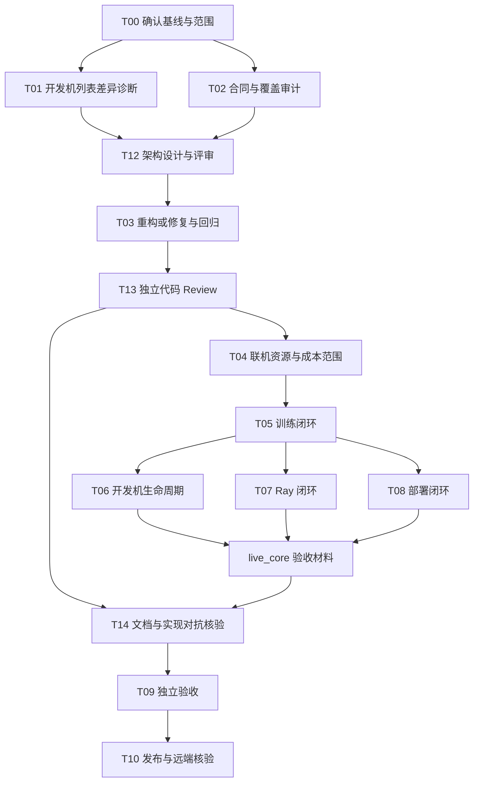

# YicloudSkill Agent 交付流程

这份流程供后续 Agent 接手本仓库：先确认已有成果，再处理真实平台差异，按选定范围补充验证，最后交付可安装的 CLI、Python 客户端和 Skill。任务依赖与初始状态保存在 [agent-tasks.yaml](agent-tasks.yaml)；它是任务清单，尚未接入自动调度器。

## 当前起点与完成范围

设计基于代码提交 `2ab800758489bcc563244bad2718341d561ad008`，记录日期 2026-10-19。以下是已有证据，执行时仍需确认工作区、目标提交和安装版本。

| 范围 | 已有证据 | 后续动作 |
|---|---|---|
| API 合同 | 固定 SDK v0.5.1；227 项目录、225 项普通 HTTP 实现 | 保持生成结果可重现；针对发现的差异修复 |
| 离线与安装 | 273 项测试；wheel 独立安装；两种安装器；三平台九组 Python CI 和 SDK 对照通过 | 对最终代码执行适用检查 |
| Mac 实机 | SSH、stdin、退出码、含空格路径的 SFTP 往返通过 | 代码涉及 SSH 时再验证 |
| 真实 API | HMAC 和部分只读接口通过 | 优先查清开发机列表与详情可见性差异 |
| 平台写操作 | 尚未联机验证 | 选定资源范围、成本上限和清理方式后执行 |
| Token / 服务账号 | 仅离线验证 | 有相应凭据时单独验证 |
| 网页终端 / WebSocket 日志 | 两项协议明确暂缓 | 保持明确报错，首版继续用 SSH 和日志轮询 |

已有验证的详细边界以 [README](../README.md) 和 [API 维护说明](../src/yicloud/skill/references/api.md) 为准。合成测试数据不能用作平台实测证据。

选择交付范围后开始调度：

- `release_v1`：完成原计划首版验收，保留写操作联测等未验证标签；已知问题必须有复现结论、可用替代路径及准确文档。上游问题可作为已说明的限制交付，不能宣称已经修复。
- `live_core`：在首版基础上，使用专用临时资源实测训练、开发机、Ray、部署的操作闭环。缺少其中某条链路时，只报告已完成部分，不宣布此范围完成。
- `extra_auth`：独立扩展，验证 Token 和服务账号；不阻塞 HMAC 首版交付。

## 角色与文件边界

共七个职责角色，同时最多运行四个 Agent，按阶段复用运行名额。工具没有子 Agent 能力时，由一个 Agent 分阶段承担职责，并明确注明没有独立评审者；只有独立任务才并行。作者不能把自己的复核标记为独立代码 Review。

| 角色 | 负责 | 主要写入范围 |
|---|---|---|
| 协调与集成 Agent | 确认目标、排任务、管理联机操作范围、集成、发布 | 文档、任务清单；负责最终集成分支 |
| 架构 Agent | 阅读实际代码、提出模块与数据流设计、评估跨层改动及兼容性 | `docs/architecture.md`、必要的设计决策记录 |
| 接口合同 Agent | 固定 SDK 对照、真实请求诊断、目录生成和特殊协议 | `tools/catalog*`、生成目录、合同测试与夹具 |
| 实现 Agent | 按通过评审的设计重构、修复客户端、CLI、工作流、SSH、安装器 | `src/yicloud/` 代码、安装脚本及对应回归测试 |
| 代码 Review Agent | 独立检查实现、跨模块调用与回归风险，复验修复 | 默认只读；提交可定位、可复现的审查意见 |
| 文档质疑 Agent | 主动寻找官方文档、SDK、项目文档、实现和测试之间的矛盾 | 默认只读；建立主张与证据对照，提出反例 |
| 验收 Agent | 按需求独立复核、包外安装、Skill 场景、失败证据 | 默认只读；回报缺陷，由实现角色修复 |

同一文件同一时间只有一个写入者。并发修改使用各自分支和独立 worktree，协调 Agent 串行集成；共享目录工作时必须先分配文件所有权。生成文件由接口合同角色统一更新，`support.md` 使用 `tools/render_support.py` 生成。验收角色从干净检出或 wheel 开始，避免依赖开发目录与作者对实现的解释。

任何联机写操作都指定一个执行者，串行执行并维护资源台账。其他 Agent 使用脱敏记录、离线夹具或只读查询，不同时创建同一批资源。

## 调度与依赖



`release_v1` 可直接沿主链交付；`live_core` 需先收齐四类联机结果，再执行最终 T09/T10。图中的分支表示依赖允许独立准备，实际平台写请求仍由一个执行者串行发送。额外认证 T11 在具备对应凭据后独立运行。

### T00：确认基线，形成运行记录

读取仓库规则、README、当前 Skill、相关参考资料及 CI；记录 `git status`、HEAD、远端目标和已安装版本。已有修改先识别归属，不能重置用户工作。

运行记录至少包含：交付范围、基准 SHA、账号别名、网关、地域、项目、可用区、允许操作的资源、费用与最长运行时间、产物路径、清理归属及发布目标。公开任务清单只记录占位符；账号配置与真实资源台账留在仓库外。

账号别名足以交接认证上下文，不向其他 Agent 复制密钥或整段聊天记录。使用已有本地配置；需要新凭据时使用 CLI 隐藏输入。延续会话已给出的授权，只有缺少实际操作范围、费用边界或会改变已有用户资源时补充确认。

### T01：先诊断开发机列表差异

当前证据是同一环境中 `ListWorkspaces` 返回空，而已知 ID 的 `GetWorkspace` 成功。不要把空列表解释为资源不存在，也不要直接猜测未公开的 URL。

1. 在相同账号、网关、地域、项目和可用区下，保存脱敏后的请求参数、列表结果、详情状态和请求 ID。
2. 使用固定提交的官方 Go SDK 发出等价只读请求；对照实际方法、路径、查询编码与响应结构，签名和认证头不进入记录。
3. SDK 成功而 Python 失败：定位最小差异，交给 T03 修复并加入合成回归夹具。
4. 两者一致为空：记录可见范围或平台合同尚待确认的证据；保持按 ID 操作路径。缺少平台证据时不宣布根因。
5. 每个假设用一个可证伪检查验证；三次未增加证据后整理结论与待平台确认的问题，继续不受影响的任务。

T01 的完成条件是诊断证据齐全并将发现的问题交给 T03；T03 负责修复后回验，避免形成任务依赖环。若表现来自上游且仍可按 ID 使用，结论可以是“限制已确认并记录”。

### T02、T12、T03：合同审计、架构设计与实现

T02 核对 227 项目录、真实方法与路径、输入校验、响应解析及两项暂缓状态；固定 SDK 再生成结果必须一致。审计以原计划的验收要求为检查项，发现缺口再加任务，避免重写已通过验证的模块。

T12 阅读当前实现与 T01/T02 的发现，维护 [架构设计](architecture.md)：模块职责、依赖方向、请求/响应数据流、公共接口、错误与重试语义、兼容性、替代方案及迁移验证。设计要说明对应的实际问题，不能只列目录。跨层修改先完成设计，局部修复可写明为何不影响现有架构。

接口合同角色检查协议与设计一致性，代码 Review 角色检查边界、复杂度和失败路径；未解决的重大设计问题退回架构角色。设计结论为“可实施”后 T03 才开始修改。架构角色可参与实现，但具体代码必须由另一 Agent Review。

T03 按设计实施重构或修复，为每个实际缺陷建立最小复现，并加入能检出原错误的回归检查。普通 HTTP、管理员写操作的“已实现”与“已实测”分别记录。不要为了把标签改成已验证而遍历执行所有写接口。

### T13：独立代码 Review

首轮审查覆盖现有核心代码与此次修改；后续逐轮检查候选 SHA 相对审查基线的差异及相关调用者。评审者需要需求和设计、完整差异、相关上下文与测试结果，不能只读作者总结或只看新增文件。

审查重点：

- 架构边界：CLI 与核心库的依赖方向、业务规则复用、循环导入、公共接口兼容、资源关闭。
- API 正确性：真实路径、字段大小写、签名字节一致性、未知字段、零值与空值、特殊响应、读写重试和结果未知语义。
- 本地与远端影响：账号隔离、所有错误路径的脱敏、下载原子替换、SSH 参数与退出码、安装冲突和用户修改保护。
- 测试有效性：原错误是否可检出，断言是否来自需求与合同，是否遗漏失败路径或仅复述实现。

每条发现必须包含严重度、文件与行号、触发条件、实际影响、代码/合同/复现依据、修复建议和复验结果。P0/P1 阻止联机写操作和发布；影响正确性或验收要求的 P2 也须修复。其余 P2/P3 可在协调角色记录依据、责任人及后续任务后延期，不能用“测试全过”关闭问题。审查结论记录被审查的 SHA；后续代码修改使受影响部分的结论失效，修复后由评审者复查。

### T14：文档质疑与矛盾处置

质疑者不参与对应实现，也不以维护作者叙述为目标。逐项提取可检验主张，例如“225 项可调用”“写请求不重试”“SSH 保留退出码”“普通错误全部脱敏”，主动构造边界条件和反例。

建立对照表：`主张 → 来源与版本 → 实现位置 → 反例/验证命令 → 观察结果 → 矛盾归属 → 处理结论`。来源优先使用固定版本官方 SDK、官方文档与实际平台证据；官方文档和 SDK 也可能互相矛盾，不能任选一方替实现背书。真实平台现象只证明对应环境和操作。

至少检查 README、Skill 入口与参考资料、CLI 帮助、示例和架构设计。尤其核对实现支持与联机实测的区分、文档中的默认值、环境网关、请求字段和错误行为。发现矛盾后交由接口合同或实现角色复现；证据不足时标记未确定，不能通过删除测试或扩大宣传口径消解矛盾。

代码错则返回 T03，并重跑受影响的 T13；文档错则由文档所有者修正，再由质疑者回验；上游差异则记录准确适用条件和替代路径。影响选定交付范围的矛盾未关闭前，T09 不通过。

### T04–T08：可选真实工作流

执行前检查项目权限、资源锁定、镜像、路径、SKU、配额组和实际资源可用性。配额允许不等于一定有空闲容量；锁定或权限不足时记录限制，不能绕过。

T04 需要确定：每类资源最大数量、CPU/GPU 规格上限、费用上限、最长运行时间、自动清理时机与负责者。未给出的范围保持 `needs_input`，继续离线工作。已有用户开发机只用于已授权的观察和 SSH 验证；生命周期测试使用本轮专门创建的资源。

| 任务 | 最小闭环 | 成功证据 |
|---|---|---|
| T05 训练 | 小型确定性任务 → 实例/日志 → 等待终态 → 产物 → 清理 | 成功状态、预期标记与产物校验一致 |
| T06 开发机 | 创建 → 就绪 → SSH/exec/传输 → 停止/启动/重启 → 清理 | 各阶段状态与连通性匹配，退出码和文件校验正确 |
| T07 Ray | 创建 → 事件/实例/日志 → Worker 更新（拓扑允许时）→ 终态 → 清理 | 任务标记、实例与 Worker 状态符合请求 |
| T08 部署 | 创建 → 就绪 → 最小服务请求 → 实例/日志 → 扩缩容/启停 → 清理 | 推理响应符合预期，实例数和生命周期状态正确 |

命令参数通过当前 `--help` 与 `api describe` 获取，创建请求先 dry-run。请求文件由实时发现的资源生成，不能原样运行 `examples/` 中的占位符。

每次创建立即登记资源 ID、操作、时间与请求 ID。写请求超时或断连后先查询远端，确认结果再决定下一步；不能重新提交创建来试探。无法确认时标记 `needs_input` 并明确执行结果未知。日志异常和未知状态均不能当作成功。

清理只针对本轮台账中明确登记的资源 ID。清理失败标记 `cleanup_pending`，停止新增资源，回报剩余资源和下一条清理命令。等待 Ctrl-C 只结束本地等待，远端资源仍需查询和清理。

### T09：独立验收

验收 Agent 获得目标 SHA、原始验收清单、已选交付范围、架构与代码 Review 结论、文档矛盾处理记录及证据索引，自行从安装包运行用户场景。先验证账号/资源发现、请求文件 dry-run、观察与故障解释，再核对选定范围的真实操作记录。给出 `通过 / 需修复 / 范围未完成`，不能因测试数量多而直接通过。

有代码改动的最终候选提交应通过以下已有检查；不要为文档修改新增镜像实现的测试：

```bash
python -m ruff check src tests tools
python -m ruff format --check src tests tools
python -m pytest -q
python tools/check_catalog.py
python tools/validate_skill.py
python -m build --no-isolation
python tools/verify_wheel.py dist/yicloud_skill-0.1.0-py3-none-any.whl
```

固定 SDK 的目录/签名再生成、uv/pipx 安装器与三平台 Python 组合由 [CI](../.github/workflows/ci.yml) 核验；需要定位失败时使用 CI 中的相同命令。版本变化后使用对应 wheel 文件名。wheel 验证必须从独立环境运行；Mac 升级后核对 CLI 与两类客户端 Skill 来自同一包。

### T10：发布

核对文档与 CLI 帮助、支持状态、许可证及秘密扫描；检查资源台账均已清理，或已明确移交需要保留的资源。提交前确认修改归属，正常提交并推送目标仓库 `main`，不强制推送，不额外发布 PyPI 或 GitHub Release。

记录本地与远端 SHA、对应 CI 链接和状态；失败则修复、追加提交并核验新 SHA 的 CI。最后在 Mac 安装该提交并进行适用的快速验证。只有代码、远端、安装包和证据对应同一最终来源，选定范围才完成。交付说明列出实际验证、仍未验证的能力与平台限制。

## Agent 交接格式

协调 Agent 派发任务时提供以下字段；接收者先复述验收条件，再执行。命令与结果属于证据，推断单独标注。

```yaml
task_id: T01
goal: 定位列表与详情的差异，或提交可复现的平台限制结论
baseline_sha: <本次实际提交>
depends_on: [T00]
write_paths: []                    # 诊断阶段只读；需要修改先分配所有权
scope_ref: <仓库外运行记录位置>     # 账号别名与操作边界，无密钥
allowed_effects: [read_api]
acceptance:
  - 相同环境与参数下完成 Python/固定 Go SDK 对照
  - 提供脱敏证据，区分观察、结论与未确定项
handoff:
  changed_files: []
  checks: []                      # 命令、目标提交、退出码、结果位置
  architecture_ref: null          # 本次适用的设计与评审结论
  code_review_ref: null           # 独立评审者、目标 SHA 与发现清单
  contradictions_ref: null        # 主张、反例和处理结论
  observations: []
  conclusions: []
  limitations: []
  created_resources: []            # 真实 ID 只在本地台账交接
  cleanup: not_needed
  next_action: <下一步与负责角色>
```

状态约定：`todo` 等待依赖，`ready` 可开始，`in_progress` 执行中，`needs_input` 缺少必要输入，`failed` 未通过验收，`cleanup_pending` 有待清理资源，`verified` 证据与清理齐全，`deferred` 明确排除于本次范围。`deferred` 不算已验证；修改验收范围必须在运行记录中说明。

可直接用于协调 Agent 的起始指令：

> 阅读 docs/agent-workflow.md、docs/architecture.md 与 docs/agent-tasks.yaml，从当前工作区重新确认基线。沿用会话授权，先运行 T00，再按依赖派发已就绪任务。每项任务声明文件所有权、外部操作范围与验收证据。实现前完成架构评审，实现后安排独立代码 Review 与文档质疑；修复后回验，不让同一作者自批。仅对已选择且资源/成本范围齐全的联机任务执行写操作。集成后由独立验收角色检查最终提交，完成发布及远端核验。无法验证的能力保留明确标签，输出真实完成状态。
