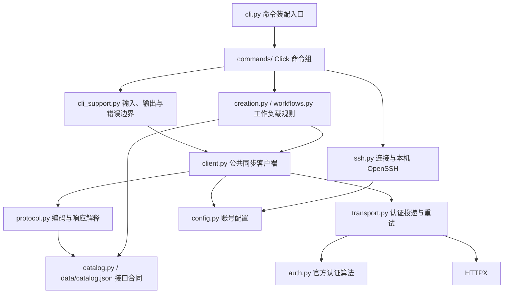

# YicloudSkill 架构设计

本文描述本次重构后的代码结构与维护约束。目标是在保留 CLI 和 Python 公共接口的前提下，让命令适配、工作负载规则、平台协议与 HTTP 传输可以分别修改和验证。架构评审与代码 Review 的执行流程见 [Agent 交付流程](agent-workflow.md)，本机检查与发现记录见 [重构复核记录](refactor-review.md)。

## 依赖方向

图中的业务层通过传入的客户端对象调用 `call`，没有导入具体客户端类；这保留了离线模拟和脚本复用能力。`cli.py` 是装配入口，下层模块不能反向导入它。核心模块不依赖 Click，也不打印或交互询问。

## 模块职责

| 模块 | 负责 | 修改边界 |
|---|---|---|
| `cli.py` | 全局选项、稳定入口 `main`、注册命令组 | 不放签名、请求字段构造或业务状态判断 |
| `commands/api.py` | 能力发现、接口描述、通用调用 | 所有请求都经过公共客户端 |
| `commands/accounts.py`、`commands/skills.py` | 本地账号与 Skill 管理入口 | 隐藏凭据输入；安装策略留给现有专用模块 |
| `commands/discovery.py` | 项目、资源与列表查询适配 | 分页复用业务层 |
| `commands/workloads.py` | 创建、生命周期、等待与日志的选项适配 | 只解析选项、调用定位/构造函数、分发执行及输出；不包装批删或决定扩缩容字段 |
| `commands/connections.py` | SSH、exec、scp 和配置输出适配 | 连接解析与进程执行留给 `ssh.py` |
| `cli_support.py` | 请求 JSON、`--set`、账号解析、输出脱敏、退出与异常边界 | CLI 专用；核心库不依赖它 |
| `creation.py` | workspace/job 快捷参数转官方请求，检查规格组合与 SKU 范围枚举 | 纯函数，不读配置、不发 HTTP、不依赖 Click 为核心输入兜底 |
| `workflows.py` | 工作负载能力映射、生命周期请求构造、分页、名称解析、等待和日志轮询 | `workload_params` 只组装已解析 ID 的请求；查询与轮询接收客户端，不选择用户账号 |
| `client.py` | `YicloudClient`、`Result`、调用顺序及资源关闭 | 同时供 CLI 与 Python 脚本使用 |
| `protocol.py` | 校验、查询编码、请求体序列化、响应模式与下载落盘 | 只从能力目录取得路径；不认证、不重试 |
| `transport.py` | HTTPX 生命周期、逐次签名、超时和有限重试 | 不解析业务信封、不做资源选择、不写产物文件 |
| `auth.py` | HMAC、Token、服务账号认证头 | 不切换账号，不因认证失败回退身份 |
| `catalog.py`、生成目录 | 已公开操作、类型与状态 | 生成目录由固定 SDK 与人工覆盖项维护 |
| `config.py`、`ssh.py`、`skill_install.py` | 本地状态、原生 SSH、包内 Skill 管理 | 保留各自原子写入、隔离与冲突保护策略 |

## 一次调用的数据流

1. 命令解析选项与 JSON；业务层组织明确项目/可用区范围内的请求。Python 用户直接调用相同客户端。
2. `YicloudClient.prepare` 委托 `prepare_request` 校验官方字段与协议支持状态，得到操作合同、查询字符串和唯一一份请求体字节。
3. dry-run 在此返回，不生成签名、不发送请求。文件下载缺少目标路径时，也在发送前报错。
4. `HttpTransport.send` 使用同一查询字符串和字节进行认证并投递；只读操作最多三次尝试，写操作一次。每次投递重新生成时间戳和认证头。
5. `decode_response` 依次判断 HTTP 状态、响应模式与业务码；普通信封、直接 JSON、空响应和文件下载分别处理。下载校验后写临时文件，再原子替换目标。
6. 客户端封装 `Result(data, request_id, raw)`；CLI 统一输出并脱敏。Python 调用者负责成功数据和原始响应的后续处理。

生命周期请求使用 `workload_params(kind, verb, resource_id, project, zone, *, extra=None, replicas=None, start=None, end=None, limit=200, instance=None)`。函数按目录筛选作用域字段、禁止额外字段覆盖作用域/ID、包装训练批量删除、验证扩缩容副本数并保留显式零值、复用日志时间与实例参数构造；不查询资源，也不修改调用者的 `extra`。名称解析仍由 `resolve` 独立执行。新业务规则进入这一层，避免脚本调用者复制 Click 回调。

列表响应使用独立 `LIST_FIELDS` 映射，不混入命令能力注册表 `WORKLOADS`。workspace/job 用 `Project/Name` 及各自 ID；Ray 用 `Namespace/DisplayName/RayJobName`，操作请求再写入 `Project/JobName`；serving 用 `Namespace/Name/ID`。所有按名定位都严格核对 `ZoneId`；缺少操作 ID 时失败，禁止把 Ray 的 UUID `Id` 猜作 `JobName`。部署列表同时兼容平台实测的 `Data` 和固定 SDK 的 `GetInferSetLogsQueryRangeData` 容器键；后者仅有离线合同依据。

错误路径统一收集当前账号凭据、实际认证头和请求中的秘密字段值，在 HTTP、业务码及下载错误消息和请求 ID 元数据中脱敏。HTTP 非成功响应只接受整数业务码，否则保留 HTTP 状态；HTTP 成功响应的畸形业务码按协议错误处理。传输错误抑制可能包含认证头的底层异常链。请求 ID、有效业务码、HTTP 状态与 `outcome_unknown` 仍可用于诊断。畸形写响应意味着无法确认执行结果，不自动重试。JSON 下载媒体类型大小写不影响错误识别。

Skill 安装先预检全部目标的归属、路径、本地编辑和新增文件冲突，再逐目标暂存与替换；可预见的第二目标冲突不会先升级第一目标。该策略不提供跨目标 I/O 全局事务，不能保证磁盘故障等异常下所有目标一起回滚。

## 关键设计取舍

| 决策 | 理由与代价 |
|---|---|
| 保留同步客户端和现有函数式业务层 | 当前 CLI 无并发调度需求；不新增异步客户端或服务框架 |
| 按命令域拆分 CLI，保留单一装配入口 | 降低不同任务修改同一大文件的冲突；模块注册必须无循环依赖 |
| 快捷创建从 Click 中提取 | 资源组合规则可独立复用；命令层仍负责文件与快捷参数互斥 |
| 协议与传输分离 | SDK 合同变化不需要修改重试策略；网络策略变化不需要修改响应解释 |
| 继续使用目录驱动通用 API | 覆盖全部公开 HTTP 操作；少量特殊响应显式处理，禁止推测 URL |
| 继续使用本机 OpenSSH | 复用主机密钥校验和进程流；需要本机工具及实际平台连接信息 |
| 不为每个接口建立 Python 方法或业务类 | 官方字段保持可见，避免 227 个包装层重复演化；常用工作流才提供便捷入口 |

`protocol.py` 的下载分支含文件 I/O，因此整个模块不是纯函数层；其请求编码部分可离线计算。当前 HTTPX 读取完整响应后再写文件，大文件流式下载留待有实际需求时单独设计，不声称已支持流式传输。

## 兼容性与验证

- 保持 `yicloud`、`python -m yicloud` 和 `yicloud.cli:main`；全部 81 个命令/命令组的参数、默认值及帮助与重构前逐项对照。
- 保持 `from yicloud import YicloudClient, Result, YicloudError`，以及 `YicloudClient` 的构造、上下文管理、`from_account`、`prepare`、`dry_run` 和 `call`。`prepare` 继续返回 `(operation, query, body)`。
- 保留已有 `yicloud.client.encode_query` 与 `scalar` 导入路径。CLI 的内部辅助函数迁入专用模块；测试中的内部 patch 路径随之调整。
- 不改变 SDK 基准、目录、平台写请求语义或账号存储格式。本次补齐 Python 客户端业务/下载错误脱敏，以及非对象写响应的结果未知标记。
- 原有签名、225 项 HTTP 合同、工作流、SSH 和安装测试继续运行；新增回归检查覆盖上面两类错误。wheel 必须在仓库外安装并实际执行各工作负载 dry-run。

联机验证范围仍以 [API 维护说明](../src/yicloud/skill/references/api.md) 为准。重构通过离线检查并不能扩大真实平台兼容性结论。开发机列表可见性问题、Token/服务账号联测和平台写操作验证继续按任务清单处理。

## 后续变更规则

跨层修改先在本文件记录接口、依赖、失败语义及备选方案，经过 T12 架构评审后实现；局部修复只需说明为何不影响架构。T13 对具体候选提交进行代码 Review，T14 主动查找文档、SDK、实现和测试间的矛盾，T09 再验证用户场景。任何修复产生新代码，都需更新受影响的评审和测试证据。
